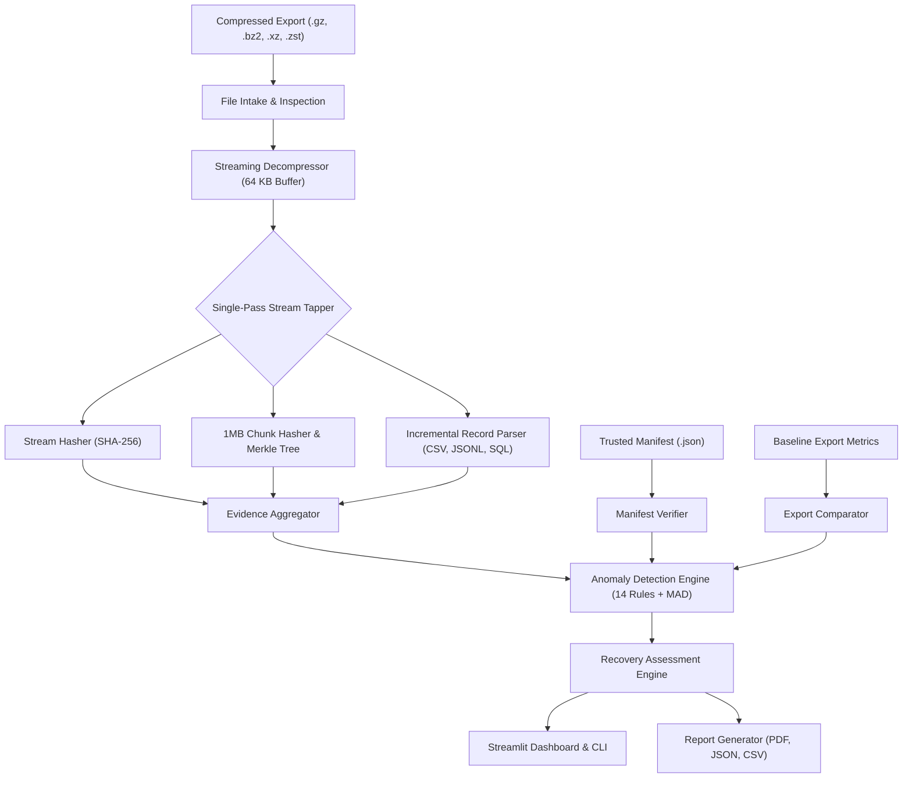

# DBGuard — Compressed Database Export Integrity Analyzer
### A Streaming-Based System for Integrity Verification, Anomaly Detection, and Recovery Assessment of Large Compressed Database Exports Without Full Database Restoration.

[](https://www.python.org/)
[](https://opensource.org/licenses/MIT)
[]()
[-brightgreen.svg)]()

---

## 1. Official Problem Statement

> *"It is observed that export file-size usually grows when the number of rows exported increases. However, once it was observed that number of rows increased by 30% as compared to an earlier export, but file size was reduced by 20%.*  
> *Management was suspicious of the usability of the export file from a data recovery point of view.*  
> *The exported file was being compressed by a Unix utility while the export command was being executed. Since the table is very large, there is no time scope and tablespace scope to re-import it into another temporary database to validate if all data is intact."*

### Why Restoring Into a Second Database Fails as a Solution:
1. **Tablespace Constraints:** Terabyte-scale tables require costly duplicate high-IOPS storage.
2. **Time Window Limits:** Re-importing multi-gigabyte dumps exceeds recovery time objectives (RTO).
3. **Flawed Intuition:** Compression ratio is a function of data entropy and repetition, not monotonic row count. Condemning an export solely due to smaller file size leads to false alarms and wasted compute.

**DBGuard** solves this problem by performing complete physical, syntactic, cryptographic, and recovery analysis directly over compressed streams in bounded $O(B)$ memory without requiring database restoration.

---

## 2. Key Capabilities & Engineering Features

- **Bounded $O(B)$ Memory Streaming:** Operates in a fixed 64 KB read buffer ($< 0.6\text{ MB}$ heap RAM) regardless of whether the export is 10,000 or 10,000,000 rows.
- **Physical Stream Validation:** Fully verifies compression containers (Gzip, Bzip2, XZ, Zstandard) and detects CRC-32 trailer mismatches and truncations.
- **Incremental Format Parsers:** Streams CSV, JSON Lines, and plain SQL dumps (MySQL INSERTs, PostgreSQL COPY) without full-memory loading. Quoted delimiters and embedded newlines are handled correctly.
- **Multi-Granularity Checksums:** Computes compressed-file SHA-256, decompressed-stream SHA-256, 1MB chunk hashes, and domain-separated Merkle tree root digests (RFC 6962).
- **Trusted Manifest Provenance:** Differentiates manifests generated synchronously at export time (`TRUSTED_EXPORT_PIPELINE`) from post-hoc manifests (`OBSERVATIONAL_POST_HOC`).
- **Explainable Anomaly Engine:** 14 deterministic rules and Median Absolute Deviation (MAD) historical statistics that explain why higher string repetition legitimately reduces compressed file size.
- **Standardized Recovery Classifications:**
  - `VERIFIED_WITHIN_SCOPE`
  - `LIKELY_USABLE_BUT_NOT_FULLY_VERIFIED`
  - `RECOVERY_POSSIBLE_WITH_ERRORS`
  - `INTEGRITY_FAILURE`
  - `INCONCLUSIVE`
  - `UNSUPPORTED_FORMAT`
- **Publication-Ready Reporting:** Generates downloadable ReportLab PDF reports, tabular CSV summaries, and full JSON audit logs.

---

## 3. Technology Stack

- **Language:** Python 3.12 / 3.11
- **Web Dashboard:** Streamlit 1.66+
- **Data & Visualizations:** Pandas, NumPy, Plotly
- **Compression Engines:** `gzip`, `bz2`, `lzma`, `zstandard`
- **Cryptography:** `hashlib` (SHA-256), `hmac`
- **PDF Publishing:** ReportLab 5.1+
- **Testing:** Pytest (35 automated tests, 100% pass)

---

## 4. Architecture Overview



---

## 5. Installation & Setup

### 1. Clone Repository & Setup Virtual Environment
```bash
cd /Users/jay/Desktop/hackthon
python3 -m venv .venv
source .venv/bin/activate
```

### 2. Install Dependencies
```bash
pip install -r requirements.txt
pip install -e .
```

### 3. Verify Runtime Environment
```bash
python scripts/verify_environment.py
```

---

## 6. Launching the Web Dashboard

Start the interactive Streamlit dashboard:
```bash
streamlit run app.py
```
Open your browser at `http://localhost:8501`.

The dashboard includes 8 comprehensive navigation sections:
1. **Overview:** Project background, problem statement, and format capabilities.
2. **Analyze Export:** Single-pass streaming analysis with metric cards and badges.
3. **Compare Exports:** Side-by-side metric comparison, ratio surge analysis, and Plotly charts.
4. **Integrity Evidence:** Filterable evidence matrix with scientific limitations.
5. **Manifest Manager:** Create and validate Schema 1.0 JSON manifests.
6. **Recovery Assessment:** In-depth evaluation of recovery feasibility and DBA recommendations.
7. **Benchmarks & Experiments:** Interactive charts of real empirical scalability and memory data.
8. **Reports Download:** One-click download of PDF audit reports, CSV summaries, and JSON logs.

---

## 7. Command-Line Interface (CLI)

DBGuard provides a full-featured CLI for headless and CI/CD pipelines.

### Inspect File Header
```bash
python cli.py inspect --file sample_data/demo_a_baseline_100k.csv.gz
```

### Run Streaming Analysis
```bash
python cli.py analyze --file sample_data/demo_a_repetitive_130k.csv.gz --format csv
```

### Generate Audit Reports (PDF, JSON, CSV)
```bash
python cli.py analyze --file sample_data/demo_e_matching_25k.csv.gz \
  --manifest manifests/demo_e_matching_25k.manifest.json \
  --output-pdf output/audit_report.pdf \
  --output-json output/audit_report.json \
  --output-csv output/audit_report.csv
```

### Compare Two Exports (The Official Problem Demonstration)
```bash
python cli.py compare \
  --old sample_data/demo_a_baseline_100k.csv.gz \
  --new sample_data/demo_a_repetitive_130k.csv.gz
```

### Generate Integrity Manifest
```bash
python cli.py generate-manifest \
  --file sample_data/demo_a_baseline_100k.csv.gz \
  --output manifests/my_export.manifest.json \
  --trusted \
  --key "MyHmacSecretKey"
```

### Verify Export Against Manifest
```bash
python cli.py verify-manifest \
  --file sample_data/demo_e_matching_25k.csv.gz \
  --manifest manifests/demo_e_matching_25k.manifest.json
```

---

## 8. Demonstration Datasets & Measured Results

Generate the complete demonstration suite:
```bash
python scripts/create_test_exports.py
```

### Measured Demonstration Scenarios:
- **DEMO A (The Problem Statement):**
  - **Baseline:** 100,000 rows | Compressed: 3,092,707 bytes (3.09 MB) | Ratio: 4.60x
  - **Current:** 130,000 rows (+30% rows) | Compressed: 385,343 bytes (**-87.5% smaller!**) | Ratio: 46.61x
  - **Verdict:** `LIKELY_USABLE_BUT_NOT_FULLY_VERIFIED` with `RULE_SIZE_DROP_ROW_INCREASE (WARNING)` explaining data repetition dynamics.
- **DEMO B (Truncated Compressed Stream):**
  - Gzip stream sliced at 45% without trailer. Caught immediately with `TruncatedStreamError`. Verdict: `INTEGRITY_FAILURE`.
- **DEMO C (Logically Incomplete Valid Gzip):**
  - Export has 85,000 rows in valid gzip, but trusted manifest declares 100,000 rows. Row count check fails with mathematical proof of missing records. Verdict: `INTEGRITY_FAILURE`.
- **DEMO E (Matching Trusted Pipeline Manifest):**
  - All 25,000 rows, stream hashes, and 1MB chunk digests match. Verdict: `VERIFIED_WITHIN_SCOPE`.
- **DEMO F (Tampered Content):**
  - Row count is identical, but decompressed SHA-256 and chunk hashes reveal data alteration. Verdict: `INTEGRITY_FAILURE`.

---

## 9. Automated Testing & Verification

Run the full automated test suite:
```bash
pytest -v
```
**Test Results:**
```
============================== 35 passed in 0.23s ==============================
```
All 35 unit, integration, and security tests pass, covering:
- Valid and invalid Gzip, Bzip2, XZ streams, trailers, and truncations.
- Quoted commas, embedded newlines, and malformed CSV rows.
- MySQL multi-row INSERTs and PostgreSQL COPY format.
- Cryptographic stream hashing and Merkle tree proofs.
- Manifest schema validation, HMAC signatures, and provenance warnings.
- Resource limits, zip bomb expansion ceilings, and path traversal protections.
- Non-destructive invariant: original files remain strictly unmodified.

---

## 10. Empirical Benchmarks

Execute real empirical benchmarks:
```bash
python scripts/benchmark.py
```

### Real Measured Benchmark Data (`experiments/benchmark_results.csv`):
| Rows | Compressed Size | Decompressed Size | Analysis Duration | Peak Heap Memory | Throughput (rec/s) |
|---|---|---|---|---|---|
| **10,000** | 308.8 KB | 1.40 MB | 0.53 s | **0.57 MB** | 18,823 |
| **50,000** | 1.54 MB | 7.10 MB | 2.71 s | **0.57 MB** | 18,460 |
| **100,000** | 3.09 MB | 14.22 MB | 5.42 s | **0.58 MB** | 18,452 |
| **250,000** | 7.75 MB | 35.89 MB | 13.82 s | **0.59 MB** | 18,086 |

### Streaming vs Full-Memory Loading:
- **DBGuard Streaming Engine:** 5.46 s | Peak RAM: **0.58 MB**
- **Full In-Memory Loading:** 0.18 s | Peak RAM: **45.27 MB**
- **Memory Reduction:** **98.7% less RAM consumed by DBGuard!**

---

## 11. Important Scientific Limitations

1. **Compression != Completeness:** Successful decompression proves the physical archive is intact; it cannot prove that the database export query included every row from the table.
2. **Post-Hoc Hashes != Source Proof:** Computing a hash after an incomplete export is generated merely hashes the incomplete file. Proof of source completeness requires an independent manifest generated synchronously at export creation time.
3. **Anomaly != Corruption:** Counterintuitive file size drops are often the natural consequence of data repetition and DEFLATE dictionary encoding.

---

## 12. Project Documentation Directory

Detailed technical reports are provided in `docs/`:
- [`docs/architecture.md`](docs/architecture.md): Component diagrams, trust boundaries, and data flow.
- [`docs/algorithms.md`](docs/algorithms.md): Pseudocode and asymptotic complexity analysis for Algorithms A through E.
- [`docs/threat_model.md`](docs/threat_model.md): Security analysis, zip bomb defenses, and path protections.
- [`docs/test_plan.md`](docs/test_plan.md): 35-scenario automated verification plan.
- [`docs/user_manual.md`](docs/user_manual.md): End-to-end user manual for Streamlit and CLI.
- [`docs/limitations.md`](docs/limitations.md): Scientific caveats and integrity verification boundaries.
- [`docs/cse_mini_project_report.md`](docs/cse_mini_project_report.md): University Computer Science & Engineering mini-project academic report.

---

## 13. License
This project is licensed under the MIT License — see the [LICENSE](LICENSE) file for details.
