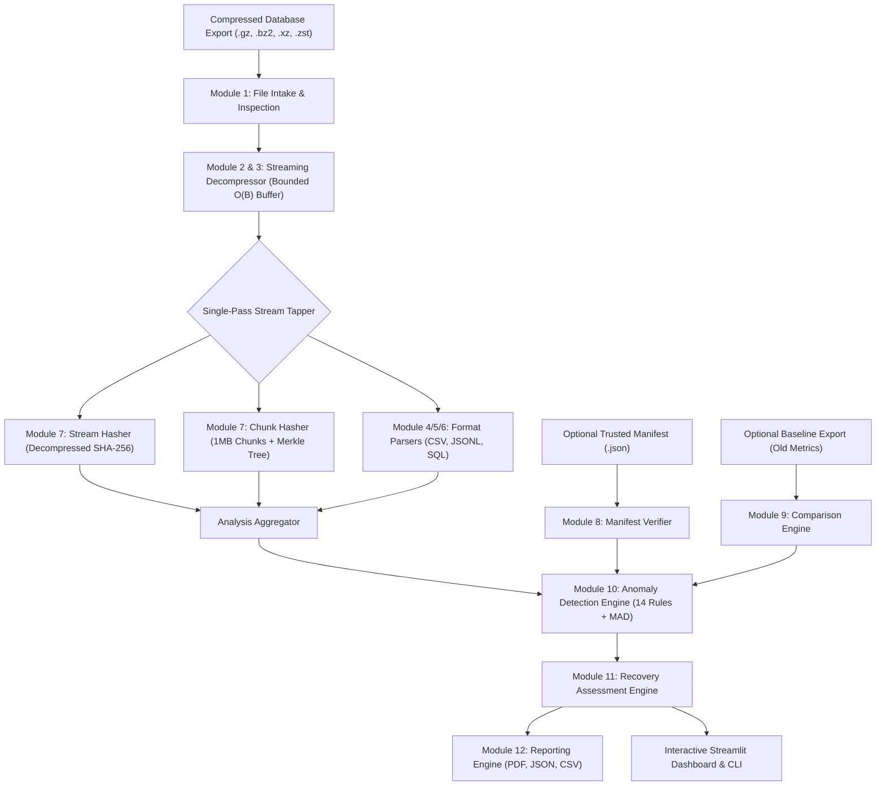
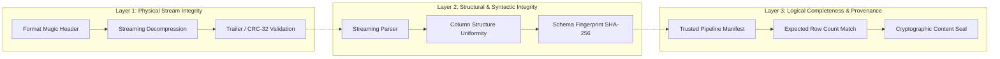

# DBGuard System Architecture

## 1. High-Level Overview
DBGuard is an enterprise-grade, research-oriented integrity verification and anomaly detection system for compressed database exports. It is engineered to operate without restoring the target database export into a secondary database.

---

## 2. Decoupled Verification Layers
A central design principle of DBGuard is the strict architectural separation of three distinct verification properties:

- **Layer 1 (Physical Container):** Verifies that the container stream is decodable, framing is intact, and CRC/Adler checksums match.
- **Layer 2 (Record Structure):** Verifies that records conform to column counts, quoted fields are correctly terminated, and column types match canonical schemas.
- **Layer 3 (Logical Completeness):** Verifies concordance with an independent manifest generated synchronously at export time by the database export pipeline.

---

## 3. Streaming Engine & Bounded-Memory Architecture
Traditional backup validation tools decompress entire archives to temporary storage disks or buffer dataframes into memory. DBGuard achieves $O(B)$ memory complexity:

1. **Chunk Generator:** Reads input files in $64\text{ KB}$ raw buffers.
2. **ChunkGeneratorReader:** An `io.RawIOBase` adapter that wraps chunk iteration, allowing standard text wrappers and CSV readers to consume uncompressed data without intermediate disk writes.
3. **Concurrent Stream Tapper:** As byte chunks pass through the reader, they are simultaneously dispatched to:
   - The uncompressed stream SHA-256 hasher.
   - The 1MB chunk boundary hasher and Merkle tree leaf builder.
   - The record parser tokenizer.

---

## 4. Trust Boundaries & Security Model
- **Untrusted Input:** All uploaded files, filenames, and manifest documents are treated as untrusted.
- **Zero Database Execution:** DBGuard never executes SQL, never connects to a live database, and avoids shell command interpolation.
- **Resource Protections:** Configurable maximum decompressed byte ceilings and expansion ratio caps prevent decompression bombs.
- **Privacy Preservation:** Diagnostic logs and reports omit raw cell content, logging only aggregate counts, inferred data types, and line numbers.

