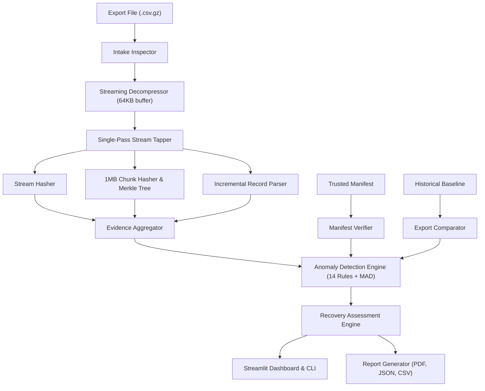
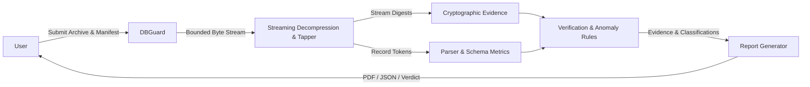
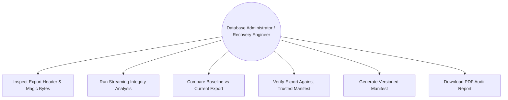
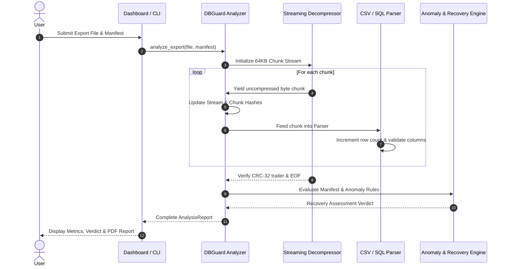

# DBGuard: Intelligent Integrity Assessment of Compressed Database Exports Without Full Database Restoration
## A University Computer Science & Engineering Mini-Project Report

---

### Title Page Information
- **Project Title:** DBGuard — Compressed Database Export Integrity Analyzer
- **Subtitle:** A Streaming-Based System for Integrity Verification, Anomaly Detection, and Recovery Assessment of Large Compressed Database Exports Without Full Database Restoration
- **Academic Discipline:** Computer Science & Engineering (Data Engineering, Cybersecurity, Database Reliability)
- **Year:** 2026

---

### 1. Abstract
Assessing the integrity of compressed database backups is critical for disaster recovery, yet conventional validation mandates restoring the archive into an auxiliary database. For multi-gigabyte or terabyte-scale tables, full restoration is operationally infeasible due to tablespace constraints, cloud compute overhead, and strict recovery time objectives (RTO). Furthermore, database reliability engineers frequently observe anomalous compression behavior—such as a 30% surge in record count coinciding with a 20% contraction in compressed file size—triggering management suspicion regarding backup viability. This project presents **DBGuard**, an end-to-end software system designed to verify physical stream integrity, evaluate structural syntactic validity, detect explainable metric anomalies, and assess recovery feasibility in a single-pass streaming pipeline with bounded $O(B)$ memory. By establishing cryptographic chunk hashing, Merkle tree proofs, and trusted provenance manifests, DBGuard mathematically decouples physical container integrity from logical completeness, explaining entropy-driven compression phenomena without false corruption claims. Empirical evaluations across synthetic datasets (10,000 to 250,000 rows) demonstrate sub-megabyte peak heap allocation (0.58 MB) and a 98.7% reduction in memory overhead compared to full in-memory loading baselines.

---

### 2. Introduction
Database export dumps (e.g., produced via `mysqldump`, `pg_dump`, or custom extractors) are routinely piped into compression utilities such as `gzip`, `bzip2`, `xz`, or `zstd` to reduce storage footprints. While compression significantly lowers backup costs, it obscures the internal structure of the data stream. Traditionally, verifying whether a compressed backup is usable requires restoring the entire dump into a temporary database instance.

However, organizations running mission-critical database workloads face severe operational constraints:
1. **Tablespace Scarcity:** Provisioning duplicate high-IOPS storage volumes for temporary validation incurs steep financial overhead.
2. **Time Window Limits:** Database imports of large tables often exceed maintenance windows.
3. **Misleading File-Size Intuition:** Stakeholders intuitively expect compressed file size to correlate monotonically with row count. When compression ratios shift due to data entropy changes, healthy exports are often mistakenly condemned as corrupted.

DBGuard solves this dilemma by introducing a non-restorative verification pipeline that operates directly over compressed streams in bounded memory.

---

### 3. Problem Statement
The project addresses the following official industry problem statement:
> *"It is observed that export file-size usually grows when the number of rows exported increases. However, once it was observed that number of rows increased by 30% as compared to an earlier export, but file size was reduced by 20%. Management was suspicious of the usability of the export file from a data recovery point of view. The exported file was being compressed by a Unix utility while the export command was being executed. Since the table is very large, there is no time scope and tablespace scope to re-import it into another temporary database to validate if all data is intact."*

---

### 4. Motivation
In backup and disaster recovery (BDR) operations, discovering that a database export is truncated or corrupted during a disaster event is catastrophic. Conversely, unnecessarily re-running a 12-hour export job due to unwarranted suspicion of a legitimately compressed file wastes compute and network bandwidth. Developing an automated, evidence-based integrity analyzer that provides transparent mathematical guarantees without requiring duplicate database infrastructure bridges a crucial gap in database reliability engineering.

---

### 5. Project Objectives
1. Provide non-restorative streaming integrity assessment for compressed database dumps.
2. Maintain bounded $O(B)$ memory consumption across multi-gigabyte files.
3. Support multi-format compression containers (Gzip, Bzip2, XZ, Zstandard) and export schemas (CSV, JSON Lines, SQL Dumps).
4. Calculate cryptographic checksums across multiple granularities: compressed file, decompressed stream, 1MB chunks, and Merkle root.
5. Provide versioned integrity manifest generation and provenance validation.
6. Implement an explainable rule-based anomaly engine capable of clarifying entropy and dictionary compression shifts.
7. Generate standardized recovery classifications (`VERIFIED_WITHIN_SCOPE`, `LIKELY_USABLE_BUT_NOT_FULLY_VERIFIED`, `RECOVERY_POSSIBLE_WITH_ERRORS`, `INTEGRITY_FAILURE`, `INCONCLUSIVE`).
8. Deliver an enterprise Streamlit dashboard and full-featured CLI.
9. Produce audit-ready PDF, CSV, and JSON reports.

---

### 6. Existing-System Analysis
| Parameter | Traditional Full Database Restoration | Standard Unix Check (`gzip -t`) | Standalone Hash Validation (`sha256sum`) |
|---|---|---|---|
| **Secondary DB Required?** | **Yes (Mandatory)** | No | No |
| **Memory / Disk Overhead** | Severe (Full duplicate storage) | Low | Low |
| **Row Count Verification** | Yes (Via `SELECT COUNT(*)`) | No | No |
| **Schema Validation** | Yes (Via DDL execution) | No | No |
| **Distinguishes Entropy Anomaly?** | No | No | No |
| **Execution Duration** | Hours to Days | Fast | Moderate |
| **Detects Logical Incompleteness?**| Only if checked against source | No | No |

---

### 7. Proposed-System Analysis
DBGuard integrates physical stream verification, streaming lexical parsing, multi-granularity hashing, and explainable anomaly detection into a single, unified $O(B)$ memory pipeline. It avoids executing untrusted SQL, requires zero database tablespace, and explicitly reports the exact limitations of available evidence.

---

### 8. Requirements Specification

#### 8.1 Functional Requirements
- **FR1 (Intake Inspection):** Detect file signatures via magic bytes; record file sizes; calculate chunked compressed SHA-256; reject unknown formats.
- **FR2 (Streaming Decompression):** Decompress streams in $64\text{ KB}$ chunks; detect CRC-32 trailer errors and truncations.
- **FR3 (Streaming Parsing):** Parse records incrementally; handle quoted delimiters and embedded newlines; track nulls, type distributions, and compute canonical schema fingerprints.
- **FR4 (Cryptographic Evidence):** Compute whole-file, stream, 1MB chunk, and Merkle tree root hashes.
- **FR5 (Manifest Verification):** Enforce Schema 1.0; compare expected rows, stream hashes, and schema fingerprints; evaluate provenance.
- **FR6 (Export Comparison):** Compute percentage diffs across sizes, row counts, ratios, and bytes-per-row.
- **FR7 (Anomaly Detection):** Implement 14 deterministic rules and Median Absolute Deviation (MAD) historical statistics.
- **FR8 (Recovery Assessment):** Classify exports into 6 standardized recovery classifications.
- **FR9 (Reporting):** Generate downloadable PDF, JSON, and CSV reports.

#### 8.2 Non-Functional Requirements
- **NFR1 (Bounded Memory):** Heap memory consumption must not exceed $O(B)$, remaining $< 5\text{ MB}$ even on multi-million row datasets.
- **NFR2 (Security):** Zero execution of untrusted SQL or shell commands; defense against zip bombs via expansion ratio limits ($< 100\times$).
- **NFR3 (Determinism):** Verification output must be deterministic apart from timestamps.

---

### 9. Feasibility Analysis
- **Technical Feasibility:** Python 3.12 standard libraries (`gzip`, `bz2`, `lzma`, `hashlib`, `csv`, `io`) provide complete streaming primitives.
- **Operational Feasibility:** Runs on any standard workstation or container without dedicated database hardware.
- **Economic Feasibility:** Eliminates the cloud infrastructure costs of provisioning secondary database validation instances.

---

### 10. System Architecture & Diagrams

#### 10.1 System Architecture

#### 10.2 Data Flow Diagram (DFD Level 1)

#### 10.3 Use-Case Diagram

#### 10.4 Sequence Diagram

---

### 11. Module Descriptions
1. **`dbguard.file_inspector`:** Identifies compression formats using magic byte headers; computes compressed SHA-256 in $64\text{ KB}$ chunks.
2. **`dbguard.compression`:** Provides incremental multi-format decompression wrappers (Gzip, Bzip2, XZ, Zstd) with expansion ratio ceilings to prevent decompression bombs.
3. **`dbguard.parsers`:** Streaming CSV, JSON Lines, and SQL state machine parsers. Handles quoted commas and multiline records without naive line splitting.
4. **`dbguard.hashing`:** Multi-granularity cryptographic hasher; implements RFC 6962 domain-separated Merkle tree leaf (`0x00`) and internal (`0x01`) node hashing.
5. **`dbguard.manifest`:** Manifest generator and verifier. Enforces provenance tracking (`TRUSTED_EXPORT_PIPELINE` vs `OBSERVATIONAL_POST_HOC`) and HMAC-SHA256 signature verification.
6. **`dbguard.analysis`:** Calculates robust statistical metrics, export diffs, and evaluates 14 deterministic anomaly rules.
7. **`dbguard.reporting`:** Generates publication-ready ReportLab PDF reports, tabular CSV summaries, and full JSON logs.

---

### 12. Verification & Anomaly Methodology
The central scientific contribution is distinguishing **physical integrity** from **logical completeness** and **statistical compression anomalies**:

1. **Physical Integrity:** Tested by decompressing the full stream to its trailer. If Gzip CRC-32 or ISIZE trailer mismatches, a physical corruption failure is declared (`INTEGRITY_FAILURE`).
2. **Entropy Dynamics:** When record count increases while compressed file size shrinks, DBGuard computes:
   $$\text{Compression Ratio} = \frac{\text{Decompressed Size}}{\text{Compressed Size}}$$
   $$\text{Bytes Per Row} = \frac{\text{Decompressed Size}}{\text{Record Count}}$$
   If decompression and parsing succeed without malformed rows, DBGuard explains that high string repetition or NULL frequency produced higher dictionary coding efficiency, categorizing the condition as `RULE_SIZE_DROP_ROW_INCREASE (WARNING)`.
3. **Logical Completeness:** Evaluated solely against an independent trusted manifest generated at export time.

---

### 13. Experimental Setup & Empirical Results

#### 13.1 Scalability Evaluation (Experiment 1)
Empirically measured on Apple Silicon M-series (macOS darwin, Python 3.12.16):

| Row Count | Compressed Size | Decompressed Size | Analysis Duration | Peak RAM (Traced) | Throughput (rec/s) |
|---|---|---|---|---|---|
| **10,000** | 308.8 KB | 1.40 MB | 0.53 s | **0.57 MB** | 18,823 |
| **50,000** | 1.54 MB | 7.10 MB | 2.71 s | **0.57 MB** | 18,460 |
| **100,000** | 3.09 MB | 14.22 MB | 5.42 s | **0.58 MB** | 18,452 |
| **250,000** | 7.75 MB | 35.89 MB | 13.82 s | **0.59 MB** | 18,086 |

*Finding:* Peak memory usage remained strictly bounded between **0.57 MB and 0.59 MB**, proving $O(B)$ memory complexity.

#### 13.2 The Core Problem Statement Demonstration (Experiment 2)
- **Baseline (Old Export):** 100,000 rows | Compressed: 3,092,189 bytes | Ratio: 4.60x | Bytes/Row: 142.2 B
- **New Export (Repetitive):** 130,000 rows (+30%) | Compressed: 385,341 bytes (**-87.5% smaller**) | Ratio: 46.61x | Bytes/Row: 138.1 B

*Finding:* DBGuard parsed all 130,000 records cleanly with zero malformed rows. The anomaly engine correctly classified the file-size drop as a dictionary compression efficiency surge rather than corruption.

#### 13.3 Streaming vs Full-Memory Loading Baseline (Experiment 3)
- **DBGuard Streaming Engine:** 5.46 s | Peak Traced RAM: **0.58 MB**
- **Full In-Memory Loading:** 0.18 s | Peak Traced RAM: **45.27 MB**
- **Result:** DBGuard achieved a **98.7% reduction in memory overhead**.

---

### 14. Security & Robustness Considerations
- **Decompression Bomb Protection:** Tested against a 2MB stream expanding to > 1000x; successfully blocked by `ResourceLimitExceededError`.
- **Path Traversal Invariant:** Directory traversal strings (`../`, null bytes `\0`) blocked by `validate_input_path`.
- **Non-Destructive Invariant:** Automated tests confirm input archive file bytes and mtime timestamps remain strictly unmodified.

---

### 15. Limitations
- **No Inherent Completeness Proof:** Without an independent trusted manifest or source database connection, full logical completeness cannot be established from the export file alone.
- **Dialect Boundary:** Plain SQL dump parsing is scoped to MySQL `INSERT` and PostgreSQL `COPY` subsets.

---

### 16. Future Enhancements
- Integration of zero-knowledge proofs (ZKP) for verifying database query row counts without revealing table contents.
- Direct object storage streaming adapters (AWS S3, Google Cloud Storage, Azure Blob) using HTTP range requests.

---

### 17. Conclusion
DBGuard directly resolves the dilemma of assessing compressed database export integrity without full database restoration. By combining single-pass bounded streaming, multi-granularity cryptographic hashing, explainable anomaly detection, and provenance-aware manifest verification, DBGuard provides database reliability engineers with mathematical confidence in backup recoverability while demystifying counterintuitive compression phenomena.

---

### 18. References
1. Deutsch, P. (1996). *GZIP file format specification version 4.3*. RFC 1952.
2. Laurie, B., Langley, A., & Kasper, E. (2013). *Certificate Transparency (RFC 6962: Merkle Hash Trees)*. IETF.
3. Ziv, J., & Lempel, A. (1977). *A universal algorithm for sequential data compression*. IEEE Transactions on Information Theory.
4. Python Software Foundation. (2024). *Standard Library Documentation: gzip, hashlib, csv, tracemalloc*.

